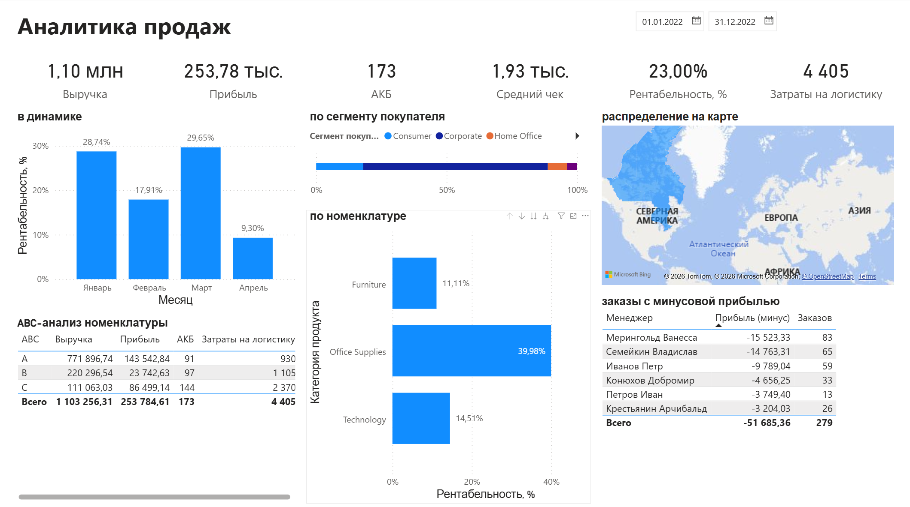
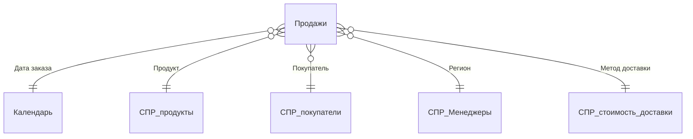

# Аналитика продаж в Power BI

[](https://github.com/TimoJR3/sales-analytics-powerbi/actions/workflows/ci.yml)


Тестовое задание на позицию BI-аналитика (принято): отчёт по продажам с шестью
ключевыми метриками, ABC-анализом номенклатуры и контролем убыточных заказов.
Модель хранится в формате **PBIP**: меры DAX, запросы Power Query и связи читаются
прямо на GitHub. Все показатели **независимо пересчитаны на Python** и совпадают
с отчётом до копейки.



## Задание

1. Рассчитать мерами: выручку, прибыль, рентабельность, АКБ (активную клиентскую
   базу), средний чек, затраты на логистику.
2. Построить: динамику показателей; показатели по сегменту покупателя; по
   номенклатуре с drill-down «категория → подкатегория → товар»; карту.
3. Посчитать ABC-анализ номенклатуры.
4. Вывести менеджеров, которые продают с отрицательной прибылью, и число таких заказов.

## Результаты

| Выручка | Прибыль | Рентабельность | АКБ | Средний чек | Логистика |
|---:|---:|---:|---:|---:|---:|
| 1 103 256,31 | 253 784,61 | 23,0% | 173 | 1 932,15 | 4 405 |

- **Убыточные заказы — 20% прибыли.** 279 заказов с отрицательной прибылью дают
  −51,7 тыс., это пятая часть итоговой прибыли. Почти 60% убытка — у двух
  менеджеров (Мерингольд и Семейкин, 148 заказов). С этого стоит начинать разбор:
  скидки, способ доставки, категории в этих заказах.
- **Категории.** Рентабельность Office Supplies 40%, Furniture — 11%, Technology — 15%.
- **ABC.** Группа A (74 товара, 70% выручки) работает с маржой 19%. Группа C (266 товаров,
  10% выручки) даёт 34% прибыли при марже 78% и 54% затрат на логистику: такая маржа
  нетипична и требует проверки исходных данных о прибыли, прежде чем делать выводы
  об ассортименте.
- **Динамика.** Рентабельность падает с 29,7% в марте до 9,3% в апреле.

## Модель данных



Звезда: факт `Продажи` и пять измерений, дата заказа подтягивается из справочника
дат в Power Query.

**Меры DAX** ([_Меры.tmdl](powerbi/Аналитика_продаж.SemanticModel/definition/tables/_Меры.tmdl)):

```dax
Рентабельность, % = DIVIDE([Прибыль], [Выручка])
АКБ = DISTINCTCOUNT('Продажи'[Покупатель])
Средний чек = DIVIDE([Выручка], [Кол-во заказов])
Затраты на логистику = SUMX('Продажи', RELATED('СПР_стоимость_доставки'[Стоимость доставки]))
Убыточных заказов =
    COUNTROWS(
        FILTER(
            SUMMARIZE('Продажи', 'СПР_Менеджеры'[Менеджер], 'Продажи'[Order_ID]),
            CALCULATE(SUM('Продажи'[Прибыль])) < 0
        )
    )
```

Убыточность считается на уровне **заказа** (сумма прибыли по строкам), а не строки:
заказ с одной убыточной позицией и прибыльным итогом не попадает в список.

ABC — вычисляемые столбцы в справочнике продуктов: выручка товара → накопленная
доля → A ≤ 70%, B ≤ 90%, C — остальное
([СПР_продукты.tmdl](powerbi/Аналитика_продаж.SemanticModel/definition/tables/СПР_продукты.tmdl)).

## Подготовка данных (Power Query)

- Лист продаж: 1 999 строк, из них 1 269 пустых — отфильтрованы, осталось 730.
- Суммы записаны текстом с пробелами и неразрывными пробелами («2 781.82») —
  очищаются и приводятся к числу.
- Справочник покупателей: у 18 покупателей несколько строк (19 лишних), и **сегменты
  в них расходятся**. Оставлена первая строка, поэтому разрез по сегментам зависит
  от порядка строк в источнике — это нужно уточнить у владельца данных.
- Справочники дедуплицируются без учёта регистра, лишние пробелы обрезаются.

## Независимая проверка

[scripts/verify_metrics.py](scripts/verify_metrics.py) повторяет очистку Power Query
в pandas и заново считает все показатели, ABC и убыточные заказы. Результат совпадает
с отчётом: выручка, прибыль, АКБ, логистика, суммы по ABC-группам и таблица менеджеров.

```bash
pip install -r requirements.txt
python scripts/verify_metrics.py
pytest -q
```

## Как открыть отчёт

1. Установить Power BI Desktop и открыть `powerbi/Аналитика_продаж.pbip`.
2. В «Преобразовать данные → Параметры» указать путь к `data/source.xlsx` в параметре
   `ПутьКФайлуДанных` и обновить данные.

## Данные

Учебный набор продаж офисного ритейлера (вариант Superstore, Канада) в формате
задания: `data/source.xlsx` и выгрузки листов в CSV.

## Структура

```text
powerbi/   PBIP: отчёт (Report) и модель (SemanticModel, TMDL)
data/      исходный Excel и CSV по листам
scripts/   независимый пересчёт метрик
tests/     pytest для логики пересчёта
docs/      скриншот отчёта
```
